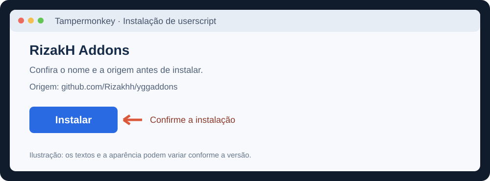

# RizakH Addons

Um conjunto de recursos para personalizar e acompanhar suas sessões no [YggIdle](https://jogo.yggidle.com.br/). O addon funciona como um script de usuário instalado no navegador e oferece recursos de caça, informações de progresso e métricas de combate.

Entre os recursos estão opções de caça e alcance, Kite, contadores de abates, acompanhamento de EXP e Chaos, DPS e dano sofrido. Alguns recursos dependem das informações disponíveis durante a sessão; as estimativas não garantem resultados. As opções de Kite protegidas exigem a senha fornecida pelo autor.

## Instalação passo a passo

Este guia usa Chrome como referência. No Brave, os passos são semelhantes; textos e posições podem variar entre versões.

### 1. Instale e ative o Tampermonkey

1. Abra a [página oficial do Tampermonkey na Chrome Web Store](https://chromewebstore.google.com/detail/tampermonkey/dhdgffkkebhmkfjojejmpbldmpobfkfo) ou escolha seu navegador no [site oficial](https://www.tampermonkey.net/).
2. Clique em **Usar no Chrome** ou **Adicionar ao Chrome** e confirme em **Adicionar extensão**. No Brave, confirme a instalação quando o navegador solicitar.
3. Abra o menu de **Extensões** (ícone de peça de quebra-cabeça) e fixe o Tampermonkey se desejar. Ele deve estar ativado no gerenciador de extensões.

### 2. Permita scripts de usuário

1. Digite `chrome://extensions/` na barra de endereços do Chrome ou `brave://extensions/` no Brave e pressione **Enter**.
2. Encontre **Tampermonkey**. Confira se a extensão está ativada e clique em **Detalhes**. Você também pode clicar com o botão direito no ícone da extensão e escolher **Gerenciar extensão**, como na imagem oficial:

3. Na página de detalhes, ative **Permitir scripts de usuário** (ou **Allow User Scripts**). Esta opção é separada da chave que ativa a extensão.

Se essa opção não aparecer, volte à lista de extensões e ative **Modo do desenvolvedor** no canto superior. Os nomes e as opções variam conforme o navegador; veja o [guia oficial de permissões](https://www.tampermonkey.net/faq.php?locale=pt_BR&q=Q209).

### 3. Instale o RizakH Addons

1. Com o Tampermonkey ativo, clique em **[Instalar RizakH Addons](https://raw.githubusercontent.com/Rizakhh/yggaddons/main/RizakH-Addons.user.js)**.
2. O Tampermonkey deve abrir uma página de instalação. Confira o nome **RizakH Addons** e clique em **Instalar**. Se já houver uma cópia com o mesmo nome, pode aparecer **Reinstalar** ou **Atualizar**; confirme para receber também os endereços de atualização.

*Imagem ilustrativa: a tela e os nomes dos botões podem variar conforme a versão do Tampermonkey.*

3. Clique no ícone do Tampermonkey e abra o **Painel**. Confira se **RizakH Addons** aparece na lista e está ativado. Caso não esteja, ative a chave ao lado do script.
4. Abra ou atualize o [YggIdle](https://jogo.yggidle.com.br/). Use **Alt + F5** para abrir ou restaurar a interface do addon.

**Se o link mostrar apenas código:** confirme que o Tampermonkey está ativado, confira a permissão de scripts de usuário e tente novamente. Confira também se o navegador não está bloqueando a extensão na página. Para scripts instalados anteriormente sem o endereço do GitHub, reinstale pelo link acima.

## Atualizações

O Tampermonkey pode verificar e instalar atualizações conforme as configurações da extensão. Além disso, o addon consulta a release pública mais recente do GitHub e, quando detecta uma versão superior à instalada, exibe um aviso com acesso à página de releases. A consulta ocorre ao abrir o jogo e depois periodicamente enquanto a página permanecer aberta. Falhas de conexão ou limites da API podem impedir temporariamente o aviso; o funcionamento do addon continua e o Tampermonkey mantém sua própria verificação.

As versões disponíveis e seus arquivos estão na [página de releases](https://github.com/Rizakhh/yggaddons/releases).

## Uso

Abra o painel no jogo e habilite somente os recursos que deseja utilizar. Os painéis de progresso e métricas ajudam a acompanhar a sessão, enquanto as opções de caça alteram o comportamento do personagem. Consulte as dicas ao passar o mouse sobre os controles para conhecer cada opção.

O addon é um projeto independente e não é uma ferramenta oficial do YggIdle. A versão distribuída é ofuscada; a ofuscação dificulta a leitura, mas não impede a recuperação ou análise do código.

## Privacidade

As configurações e métricas do addon são armazenadas localmente no navegador de cada jogador e não são incluídas no instalador. Para verificar atualizações, o addon consulta a API pública do GitHub sem enviar cookies ou métricas; o GitHub ainda recebe os dados normais de conexão, como o endereço IP. Recursos que interagem com o jogo usam a própria conexão do jogador com o YggIdle.

## Histórico de alterações

Consulte o [changelog](CHANGELOG.md) para acompanhar as mudanças de cada versão publicada.

## Problemas

Para relatar um erro ou sugerir melhorias, abra uma [issue](https://github.com/Rizakhh/yggaddons/issues) informando a versão do addon, navegador, situação e, se possível, uma captura de tela.
